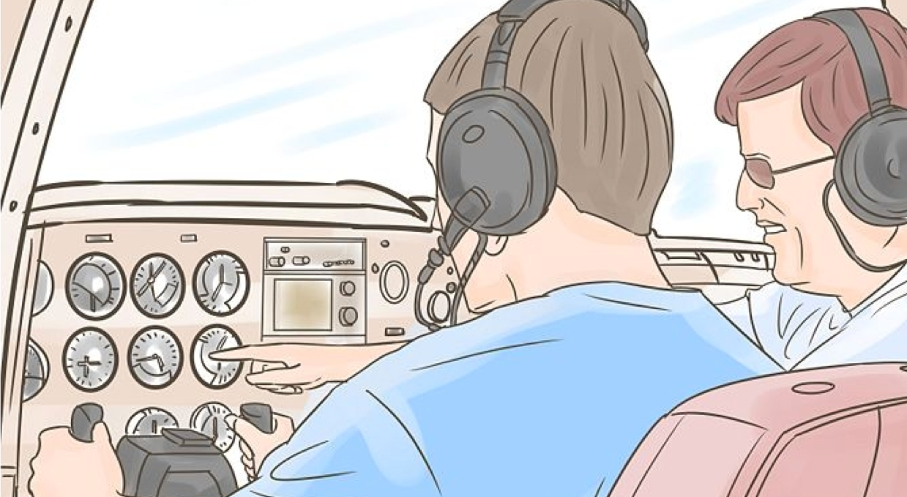

# Legal AI Engineering

### Building Private, Defensible AI for Law

Elephant Scale

---

## Two Days, Two Questions

> **"Where did that document go?"**
>
> **"Prove the system did what you say it did."**

Someone will ask you both. Opposing counsel, a judge, a client's GC, a CISO, a state
regulator, a CJIS Systems Officer.

By tomorrow evening you will have built a system that answers both — and you will walk out
with the artifacts that *are* the answers.

Notes:

Open here, on the two questions. Do not open with "AI is transforming legal." Everyone in
the room already believes that; it buys nothing. The two questions are the course. Write
them on the board and leave them there for two days — every lab gets tied back to one of
them.

Ask who has already had to answer a client security questionnaire about an AI feature. The
hands that go up are your allies for the rest of the course.

---

## Prerequisites and Expectations

* **You can write Python and call an API**
  - Labs are Python; nothing exotic, no ML framework, no model training
  - If you can read a `for` loop and a `requests` call, you can do every lab

* **No legal background required**
  - Privilege, responsiveness, elusion, TAR, load files, custodians — taught in context,
    at the moment each one first costs you something as a builder

* **No ML background required**
  - We build the mental model from the API surface down, not from the math up

* **Curiosity, and skepticism**
  - Argue with me. Every claim in this course should survive being challenged, because
    in this field it eventually will be — under oath

Notes:

Say the "no legal background" line explicitly and early. Engineers moving into legal tech
are often quietly worried that the room will assume knowledge they don't have. Defuse it
in the first five minutes and you get real questions for two days instead of silence.

---

## Our Teaching Philosophy

* Emphasis on **concepts and fundamentals** — the primitives outlive the products
* **Highly interactive** — questions and disagreement welcome at any moment
* **Hands-on** — learn by doing; the labs are half the course
* **Taught from the builder's seat** — the instructor ships a real on-prem eDiscovery
  platform (FreeEed) and teaches AI security; you build your own pipeline in the labs,
  designed against that architecture rather than against a demo
* **Honest about limits** — you will see a local model lose to a cloud model, in front of
  you, and we will talk about what to do about it

Notes:

The "builder's seat" line is the differentiator. Say it once here, then stop claiming it
and start demonstrating it — the Tika/PST/OCR war stories in Module 2 and the egress
attestation in Module 5 do the work.

---

## Analogy: Learning To Fly...


Notes:

You can read about flying all day. At some point you have to sit in the seat.

---

## + Flight Time



Notes:

The labs are the flight time. The labs are not illustrations of the lecture; the lecture is
preparation for the lab.

---

## One System, Seven Labs

The labs are **not** seven exercises. They are **one system, built in seven steps.**

```text
  Lab 02  messy corpus      ->  catalog.jsonl   (ingest, extract, OCR, dedupe)
  Lab 03  catalog.jsonl      ->  search index    (find anything inside everything)
  Lab 04  search index       ->  RAG + citations (answers you can go check)
  Lab 05  RAG                ->  local + attested (nothing left the building)
  Lab 06  local RAG          ->  measured review (recall, elusion, precision)
  Lab 07  measured review    ->  scored + packaged (SAIS-100, on-prem bundle)
  Lab 08  all of it          ->  CAPSTONE: your portfolio project
```

Every lab consumes the previous lab's output. Break step 2 and step 5 doesn't run — which
is also true of the real thing.

> At the end you do not have notes. You have a **running system** and the
> **evidence file** that defends it.

Notes:

Show this early and refer to it at every lab hand-off ("you are here"). The compounding
structure is the single biggest reason this course lands better than a topic-per-module AI
course. It also creates real stakes: a student who skips Lab 03 feels it in Lab 04.

Warn them now: if they fall behind, the fix is to take the *reference output* from the
previous lab (shipped in every lab folder) and move on. Nobody gets stranded.

---

## What You Will Walk Out With

Not notes. **Artifacts.**

| Day 1 | Day 2 |
|---|---|
| An ingestion pipeline over 1,400+ file types | An egress attestation for a local model run |
| A document catalog with hashes and dedupe | A recall / elusion / precision measurement |
| A real eDiscovery search index | A reproducibility bundle (the "case snapshot") |
| A RAG answer with checkable citations | A SAIS-100 score with a legal overlay |
| | A containerized, on-prem-deployable system |

Plus the reusable paperwork: the defensibility checklist, the reproducibility manifest
template, and the privilege/egress attestation form.

Notes:

Show this slide before the first lab. It reframes the labs from "exercises" to "deliverables"
and it is the slide people photograph. The right-hand column is also, almost word for word,
the list of things a legal-tech hiring manager asks about.

---

## The Shape of the Two Days

**Day 1 — Build the foundation: ingest, search, retrieve**

1. The legal engineer's landscape
2. Legal data is messy — ingestion and extraction
3. Search and retrieval — the foundation
4. RAG for legal documents — with citations

**Day 2 — Make it private, defensible, and shippable**

5. Privacy, privilege, and local serving — the privilege trap
6. Defensible AI review
7. Ship it — workflow, private deployment, and governance
8. Capstone

**Optional Day 3 / modular** — investigations · agentic legal workflows · deployment at
scale · governance and compliance deep-dive

---

## Ground Rules

* **Ask the question when you have it.** Not at the end.

* **The parking lot is real.** Anything jurisdiction- or matter-specific goes on the board
  and gets answered before we close.

* **No client data in any tool during this class.** Not a document, not an extract, not a
  "scrubbed" sample. Everything we use is synthetic and generated on your own machine.
  Module 5 is ninety minutes on exactly why — do not make it a live demonstration.

* **If I don't know, I will say so.** This field is eighteen months old. There are real
  open questions and I would rather name them than paper over them.

Notes:

The third rule matters more here than in any other course we teach. Someone *will* be
tempted to bring a real PST to Lab 02 "to see if it works." The answer is no. The reason
becomes Module 5. If they want their own data processed, they install FreeEed afterwards
and run it on their own machine, which is the entire point of the product.

---

## About the Instructor

* **Ten-plus years in eDiscovery** — ingestion, processing, review, production
  - Not *AI for legal* observed from the outside. The unglamorous parts, from inside the
    pipeline — which is why Module 2 exists at all

* **Author of FreeEed** — the open-source, on-prem eDiscovery platform
  - Every Tika / PST / OCR / load-file war story in this course is one I own in a bug tracker

* **Ten-plus years of technical training** — Big Data, Hadoop, Spark, and now AI
  - *Guide to Big Data Applications* (Springer, 2017), *HBase Design Patterns* (2015),
    *Hadoop Illuminated* (2012); technical reviewer for Manning and Packt
  - Certified Google Trainer

* **A law degree** — earned online, **in order to** build the software
  - Not a detour that happened alongside the work. A deliberate decision that you cannot
    build eDiscovery software on a second-hand understanding of what the law requires
  - I am **not** a lawyer, I am not your lawyer, and nothing here is legal advice

* **Author of *Legal AI Engineering*** — the material you are holding

> I ship the thing I am teaching you to build. When I tell you a local model loses to a
> cloud model, it is because I have watched it happen on my own hardware.

Notes:

Keep this to ninety seconds. The room does not want a resume; it wants one reason to trust
you for two days. That reason is the second bullet — you maintain an eDiscovery platform, so
the failure modes in Module 2 are yours, not a vendor's slide deck.

The law-degree bullet carries more weight than it looks. The point is the word *for* — the
degree was taken **to build the software**, not collected along the way. That is the whole
thesis of the course in one biographical fact: the legal requirements are not a wrapper you
put around a working pipeline afterwards, they are an input to the design. Say it that way.

Then say "not a lawyer, not your lawyer, not legal advice" out loud and move on quickly. In
a room that may contain actual lawyers, claiming less than you could is the only safe
direction — and it buys credibility rather than spending it.

Do not oversell the books. They are Big Data books, not legal-AI books; the honest framing
is "I have been teaching engineers hard things for a decade," not "I am a published legal
AI authority."

---

## About You

* About you
  - Your name, and what you build
  - Are you coming from software into legal, or from legal into software?
  - What touches your system today: documents? email? scans? a review team? a court?
  - Your familiarity with LLMs (1–4; 1 = new, 4 = shipped something into production)
  - What you personally want to walk out with

 &nbsp;
 &nbsp;


Notes:

Capture the "what do you want to walk out with" answers on the board and check them off at
the close. Cheapest engagement device in the course.

The software-vs-legal split matters for pacing: a room of legal-tech engineers needs less
Module 1 and more Module 6; a room of software engineers needs the opposite. Ask, then
adjust the clock, and say out loud that you are adjusting it.

---

## Where Are You On This Curve?

Quick poll, hands up:

* My company has **no** AI in the product
* We have AI in the product and it calls a **cloud** model
* We have AI in the product and we have had to answer a **client security questionnaire**
  about it
* We run a **local** model in production
* We have had to defend an AI-assisted process to **opposing counsel or a court**

And the second question: **can you, today, prove where a given document went?**

Notes:

Do this literally. The second question is the interesting one. Almost nobody can, and the
gap between "we're careful" and "we can prove it" is the commercial opportunity this entire
course is about. Land that, then move.

---

# Let's Begin

---
