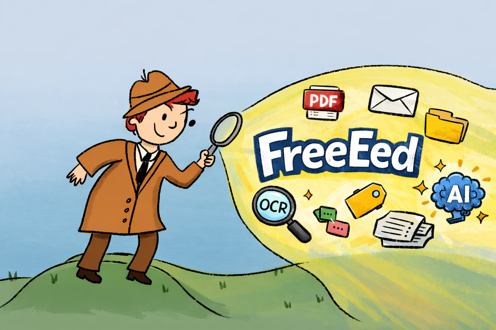

# Module 1 — The Legal Engineer's Landscape

Elephant Scale

---

## Why Start Here

You are about to build software whose output may be read aloud in a courtroom.

That changes the engineering. Not the languages, not the frameworks — the **acceptance
criteria**. "It works" is not a criterion. "It works, nothing leaked, and I can prove both"
is.

This module gives you the map: what the market has already bought and what it still cannot
do, what the role is, where AI actually fits in legal work, and the two risks that will be
behind every design decision you make for the next two days.

Notes:

Keep this module tight — 50 minutes. It is the only module with no lab, and a room of
engineers will get restless if you lecture for ninety minutes before they touch a keyboard.
Part 1 is the market evidence and should take seven minutes, not fifteen. If the room is
mostly legal-tech people already, cut the EDRM section to five minutes and bank the time for
Module 6.

---

# Part 1 — The Legal AI Implementation Gap

---

## Legal AI Adoption Is Accelerating

Three survey reports. Three different populations. One direction.

| Report | Population · fieldwork | The number |
|---|---|---|
| **ILTA 2026 Technology Survey** | 508 law firms · published Sept 2026 | **94%** are now *engaged with* generative AI — **up 14 points** in one year |
| **Wolters Kluwer Future Ready Lawyer 2026** | 810 lawyers, firms and in-house · fielded Aug 2025 | **92%** use at least one AI tool in their daily work |
| **Thomson Reuters Institute — AI in Professional Services 2026** | 1,514 professionals · fielded Oct–Nov 2025 | **41%** of law firms and **47%** of corporate legal departments are *already using* GenAI (40% across all professions, up from 22%) |

* Twelve months earlier, **one firm in five** reported no GenAI engagement at all. ILTA says
  that holdout population "has all but vanished."
* For the first time in that survey's history, an emerging technology is the **primary focus
  of law firm technology investment**.
* Now read the verbs. *Engaged with* is not *deployed*. *Using* is not *governed*.
* And read the fieldwork column — two of these "2026" reports were fielded in **2025**. A
  number without its population and its date is not a finding. Module 6 again.

> The adoption argument is over, and you arrived **after** it. Nobody here has to sell AI to
> a law firm — which means what is left is the hard part.

Notes:

Five minutes, maximum. Do not read the table aloud; put it up, say the three headline numbers,
and move to the verbs. The verbs are the teaching point and the rest is scenery.

Sources — all figures below are quoted from the primary reports, not from press coverage:

* **ILTA 2026 Technology Survey**, Executive Summary (free; the full report is paid), published
  September 2026. 508 responding firms, "representing over 139,000 lawyers and approximately
  275,000 total users." Verbatim: *"Nearly every responding firm (94%) is now engaged with
  GenAI, up 14 points from last year."* Also verbatim: *"Just twelve months ago, one in five
  firms reported no GenAI engagement at all. That holdout population has all but vanished"*
  and *"For the first time in this survey's history, an emerging technology has become the
  primary focus of law firm technology investment."*
  <https://www.iltanet.org/resources/surveys-2026> · exec summary PDF:
  <https://higherlogicdownload.s3.amazonaws.com/ILTANET/ce7f3e74-fb70-402e-a1b3-5dc0abe72260/UploadedImages/Misc%20PDFs/2606_ILTA_Executive_Summary_FINAL__1_.pdf>
* **Wolters Kluwer Future Ready Lawyer 2026**, released 10 March 2026. 810 lawyers in law firms
  and corporate legal departments in the U.S., China and Europe; online fieldwork **8–25 August
  2025**. 92% use at least one AI tool in daily work; 62% report time savings of 6–20% of the
  work week. <https://www.wolterskluwer.com/en/know/future-ready-lawyer-2026>
* **Thomson Reuters Institute, 2026 AI in Professional Services Report** (fourth edition).
  1,514 respondents, online, **October–November 2025**, 27 countries (39% U.S.); 47% of
  respondents worked in law firms, 17% in corporate legal. Verbatim key finding: *"Four-in-ten
  respondents say their organizations are using GenAI, up from 22% last year."* The 41% / 47%
  split comes from the report's own "Current usage comparison, GenAI v. Agentic AI" chart.
  <https://www.thomsonreuters.com/en/institute/reports/2026-ai-in-professional-services-report>

Two honesty notes, and say the first one out loud if anyone in the room is a researcher:

1. **These are not the same question.** ILTA counts *firms* "engaged with" GenAI — which
   includes evaluating it. Wolters Kluwer counts *individuals* touching a tool. Thomson Reuters
   counts *organizations* that say they are "already using" it. The gap between 94% and 41% is
   mostly definitional, and pointing that out is more valuable than the numbers are.
2. **"2026" is a report title, not a field date.** Wolters Kluwer's 2026 survey was fielded in
   August 2025 and Thomson Reuters' in October–November 2025. Only ILTA's is 2026 fieldwork.
   Adoption has moved since; the direction is the claim, not the decimal.

Figures deliberately **left off** this slide because they could not be confirmed in a primary
report — do not add them back without a source:

* ILTA product-level shares (Harvey, CoCounsel, Claude, Kira, Lito, "Copilot at 76%") — these
  circulate in vendor blog posts; the free executive summary does not publish them.
* ILTA's "85% of small firms to 100% of firms over 700 lawyers," "78% have a formal policy,"
  "79% use GenAI for initial drafts," "accuracy is the top concern at 63%, down from 82%," and
  "60% expect the profession to look significantly different in ten years." The executive
  summary states it reports **firm-size breakouts rather than aggregate averages**, and those
  aggregates are not in it.
* "41% of law firms, up from 28%, and 47% of corporate legal, up from 23%." The 2026 figures
  are in the Thomson Reuters chart; the segment-level 2025 priors are not. Only the all-sector
  22% → 40% movement is published.

---

## The Missing Piece Is Engineering

A firm can license every product in ILTA's top twenty and still have none of the following.

| What the licence does not include | The 2026 evidence |
|---|---|
| **Integration** — find the paths AI already arrived through | Among firms that enabled Copilot / Teams Premium features, Copilot Chat is the most commonly activated (**81%**) — capability appearing with no discrete deployment event *(ILTA)* |
| **Evaluation** — know whether it works, in numbers | Only **18%** of organizations collect any ROI metric for AI; **40%** do not know whether theirs does *(TR)* |
| **Customization** — one policy per client, not one per firm | Two-thirds of corporate clients say their outside firms should use AI, under **20%** mandate it, and **40%** of professionals have been told both to use AI and not to use it, depending on the client *(TR)* |
| **Security** — a control, not a sentence in a policy | GenAI entered ILTA's tracked security-challenge list for the first time and took **second place**, above malware and compliance. "No confidential/sensitive info" is written policy at **29%** of firms under 50 lawyers and **53%** of firms over 700 |
| **Deployment** — make the sanctioned path faster than the unsanctioned one | **34%** of law firm professionals use AI tools their firm has not authorized; **50%** say their firm's AI strategy is invisible in day-to-day work *(TR)* |

* ILTA's own forecast, in its own words: firms "anticipate additional headcount needs across
  IT, innovation, security, training, knowledge management, and data science."
  - That sentence is the commercial rationale for this role, written by the industry's own
    technology association rather than by a trainer.

> Buying the software settles the procurement question and opens the engineering one. The
> engineering one is the only one a court will ask you about.

Notes:

This is the slide that pays for the room. The whole argument is one move: every statistic on
it is a *post-purchase* problem. The software was already bought. These are the things that
were still missing the next morning, and each one is a line item in somebody's budget.

Work the rows against the room. Ask who has been handed a Copilot tenant they did not
provision — in a firm audience, hands go up, and that is the integration row proving itself.

The security row is the one to slow down on. "No confidential or sensitive information" at 29%
of small firms is a **policy**, and a policy is a sentence, not a control. A sentence cannot
tell you where a document went. Plant that here and harvest it in Module 5 and again in Lab 12,
where the lesson is stated as **capability is not configuration** — a guard that exists but is
running in observe-only mode fails the question that matters.

The evaluation row is the setup for Module 6: 18% collecting any metric means the overwhelming
majority of legal AI in production right now is unmeasured. An unmeasured review is not
defensible, whoever built the tool. That is the entire market for the skill being taught here.

Sources:

* **ILTA 2026 Technology Survey**, Executive Summary (as cited on the previous slide). Copilot
  Chat 81%, the "no discrete deployment events" observation, the security-challenge second
  place, and the policy table (Q3.18, broken out by firm size) are all in the free summary.
  Note that ILTA's full named concerns are GenAI-powered social engineering first, then
  detecting anomalous GenAI behavior, preventing GenAI agent abuse, third-party GenAI security
  risk, prompt injection and data/model poisoning — which is, almost line for line, the Day 3
  agentic-security module.
* **Thomson Reuters Institute, 2026 AI in Professional Services Report** — ROI metrics (18%,
  40% don't know), client mandate figures, and the 40% "told both" figure are verbatim key
  findings. <https://www.thomsonreuters.com/en/institute/reports/2026-ai-in-professional-services-report>
* **Thomson Reuters Institute, Future of Professionals 2026 — Legal** — 736 law firm
  professionals across 46 countries (421 in the U.S.) plus 203 in-house, fielded **March–April
  2026**. Verbatim: *"some 34% of law firm professionals say they are currently using AI tools
  their firm has not authorized."* Half say their firm's AI strategy is invisible in day-to-day
  work; 41% say the right tools are not yet in place.
  <https://www.thomsonreuters.com/en/institute/future-of-professionals-2026/report-legal>
* **Wolters Kluwer Future Ready Lawyer 2026** — the top two barriers to wider AI use are tied
  at **39%** each: ethical concerns including data privacy, and inadequate training. Useful if
  the room pushes back on the training argument, since it is their own profession's answer.
  <https://www.wolterskluwer.com/en/know/future-ready-lawyer-2026>

If you have an engineering-only room, cut this slide to ninety seconds and keep only the
security and evaluation rows. Engineers do not need convincing that a licence is not a system;
they need the two specific gaps this course closes.

---

# Part 2 — The Role

---

## What Is a "Legal Engineer"?

The person who sits between the people who **know the law** and the systems that **process
the documents**.

* Not a lawyer who learned Python
* Not a developer who read a blog post about eDiscovery
* Someone who can take a legal requirement — *"produce every responsive, non-privileged
  document, and be able to defend how you found them"* — and turn it into a pipeline,
  a metric, and an audit trail

> A legal engineer's job is to make a legal obligation **executable**, and then
> **provable**.

Notes:

The title varies by employer: legal engineer, AI legal engineer, eDiscovery engineer, legal
solutions architect, litigation support engineer, forensic technologist. Same job. Say that,
so nobody disqualifies themselves over a job title.

---

## Why This Role Is Being Hired Right Now

Three things collided:

* **Volume** — matters now routinely involve millions of documents; manual review does not
  scale and stopped being affordable years ago
* **Capability** — foundation models made reading, classifying, and summarizing documents a
  configuration task instead of an 18-month ML project
* **Constraint** — the one thing you cannot do with a legal document is **send it to a
  stranger**, and courts have started saying so in writing

The scarce skill is not "can use an LLM." It is **"can use an LLM on material that is not
allowed to leave."**

> Volume creates the demand. Capability makes it possible. The constraint is why they
> need *you* and not an API key.

Notes:

This slide is the argument; Part 1 was the evidence for it. If anyone asked "says who?"
during the adoption slide, this is where it pays off — the ILTA headcount forecast (IT,
innovation, security, training, knowledge management, data science) is the industry naming
this role without naming it.

This is the thesis of the course. Land it hard. The third bullet is the moat: anybody can
wire a chatbot to a cloud API in an afternoon. Doing it where the data cannot leave, and
producing the evidence that it did not, is a real engineering discipline — and it is
teachable in two days, which is why this course exists.

---

## Who You Work For

| Employer | What they need from you |
|---|---|
| **Legal-tech product company** | Ship AI features clients' security reviews won't kill |
| **Law firm (litigation support / innovation)** | Build internal tools; keep privilege intact |
| **Corporate legal department** | Reduce outside-counsel spend; govern AI use |
| **Service provider / vendor** | Process at volume, defensibly, under a contract |
| **Government / regulator / investigator** | Work regulated records inside a boundary (CJIS, FedRAMP) |
| **Yourself** | Small firms and solos cannot afford the incumbents |

Notes:

The last row is underrated and worth thirty seconds. The cost floor on eDiscovery has
collapsed — a capable engineer with open-source tooling and a local model can now serve
small firms that were priced out entirely. That is FreeEed's whole market thesis.

---

# Part 3 — Where AI Fits in Legal Work

---

## The Five Places AI Earns Its Keep

* **eDiscovery** — find the responsive documents in a mountain of them
* **Document review** — classify at scale: responsive, privileged, hot
* **Contracts** — extract clauses, compare to a playbook, flag deviations
* **Legal research** — find authority, summarize, check it (the part people skip)
* **Investigations** — who knew what, when, and who did they tell

* Underneath all five: **retrieve the right text, then reason over it.**
  - Which is why Modules 3 and 4 are the spine of this course

> Five markets, one primitive. Build the primitive well and you can serve any of them.

Notes:

Ask the room which of the five they are being paid to work on. Use the answer to decide how
much of the optional Day 3 material to preview. Contracts people need the extraction and
agentic content; eDiscovery people need defensibility.

---

## The EDRM, In Plain Terms

The **Electronic Discovery Reference Model** — the industry's standard picture of a matter.
Nine stages. You will hear it constantly, so here it is once, honestly:

```text
Information    Identification   Preservation   Collection
Governance  ->       |        ->      |      ->     |
                     v               v              v
                 Processing   ->   Review   ->   Analysis
                     |                              |
                     v                              v
                 Production  ->  Presentation  (to the other side / the court)
```

* **Where your code lives:** Processing, Review, Analysis, Production
* **Where your code must not break things:** Preservation and Collection — that is
  *forensic* territory, where altering a byte is a sanctionable event
* **Where the money is:** Review. It was always Review. Review is ~70% of the cost of a
  matter, and it is the part AI actually changes

Notes:

Do not teach the EDRM as a framework to memorize. Teach it as a map of *where your pipeline
plugs in* and *where you must keep your hands off*. The Preservation/Collection warning is
the one that matters: an engineer who "normalizes" collected evidence in place has destroyed
it. That is why FreeEed treats "no outbound calls and no mutation during processing" as a
hard rule.

---

## The Vocabulary That Will Cost You If You Fake It

* **Custodian** — the person a document came from. Every document carries one. Your schema
  needs it on day one, not day thirty.
* **Responsive** — relevant to the request in *this* matter. Not a property of the document;
  a property of the document *and* the request.
* **Privileged** — protected from production (attorney-client, work product). Producing one
  by accident is the nightmare scenario.
* **Hot / smoking gun** — the document the case turns on. Rare, high-value, and the thing
  everybody actually wants your tool to find.
* **Load file** — the plain-text file (`.dat`, `.opt`) that carries metadata and page
  mappings between platforms. 1990s technology. Still how the industry moves data.
* **Bates number** — the per-page identifier stamped on produced documents. The citation
  format of litigation.
* **Production** — handing documents to the other side, in an agreed format, with an agreed
  manifest.

> Responsiveness is **relative to a request**. Privilege is **relative to a relationship**.
> Neither is a document attribute — both are a *judgment* your system records.

Notes:

That takeaway is the single most important sentence in the module for a software engineer.
Developers model "responsive" as a boolean column on the document table, and then the second
request arrives and the data model is wrong. Coding decisions belong to (document, matter,
request), and they belong to a *reviewer*, with a timestamp and a reason.

---

## Build vs. Buy

**Buy** when:

* The workflow is commodity and the incumbent is good at it (hosted review platforms are)
* You need a vendor to stand behind the output in court
* You have no engineering capacity to own a pipeline

**Build** when:

* The data **cannot leave your building** — this is the big one
* Per-GB pricing on a large matter exceeds a year of engineering
* You need a workflow nobody sells, or integration with systems nobody supports
* You need to **pin** the model and reproduce a review a year later (you cannot pin
  somebody else's hosted model — see Module 6)

* Most real answers are **both**: buy the review platform, build the private AI layer.

> "Buy" and "build" is a false binary. The real question is: **which part of this is the
> part that has to be yours?** Usually it is the part that touches the data.

Notes:

Push back on anyone who says "we'd never build." They already did — the integration glue,
the load-file munger, the dedupe script. The question is whether they do it deliberately.

The model-pinning argument in the fourth build bullet is the one legal buyers have not yet
internalized, and it is a durable differentiator for anything you build locally. Plant it
here; harvest it in Module 6.

---

# Part 4 — The Two Risks

---

## Risk 1 — Confidentiality and Privilege

The question: **where did the document go?**

* Every document in a matter is somebody's confidential material, and some of it is
  **privileged**
* The moment it is sent to a third-party AI endpoint, that endpoint is **in scope** — of
  the protective order, of the client's confidentiality obligations, of CJIS or HIPAA or
  whatever regime applies
* "We have an enterprise agreement and they don't train on our data" is a **contractual**
  answer. It is not a **physical** answer. Module 5 is about the difference.

> You cannot un-send a document. There is no incident response for disclosure.

Notes:

This is the risk engineers underrate, because in ordinary software a data-handling mistake
is remediable: rotate the key, notify, patch. Privilege is not remediable. The protection
either held or it didn't, and if it didn't, the material may be fair game. Say that plainly.

---

## Risk 2 — Defensibility

The question: **can you prove what the system did?**

* A review is not judged on whether it was *right*. Nobody can know that — the whole point
  is that no human read all the documents
* It is judged on whether the **process was reasonable and documented**
* Which means your system's real output is not the classification. It is the **record**:
  what model, what prompt, what retrieved text, what measured recall, who approved it

* Three things make a process defensible:
  - **Measured** — you have numbers (recall, elusion, precision), from a blind sample
  - **Transparent** — you can say *why* this document was coded this way
  - **Reproducible** — someone can re-run it and get the same determinations

> In litigation, an **unmeasured** correct answer is worth less than a **measured**
> imperfect one.

Notes:

That takeaway reliably produces an argument, which is good — have it. The engineer's
instinct is "optimize accuracy." The legal reality is "demonstrate reasonableness." A 78%
recall review with a documented, validated methodology is defensible. A review that is
probably 95% but was never sampled is not, because you have nothing to say when asked how
you know.

This is also the sales argument for everything in Module 6, so don't resolve the tension
here — just name it.

---

## The Two Risks Are Why This Course Exists

| | The risk | The claim you must be able to make | Where we build it |
|---|---|---|---|
| **1** | Confidentiality / privilege | *"Nothing left the building, and here is the attestation."* | Module 5, Lab 05 |
| **2** | Defensibility | *"Here is exactly what it did, and you can re-run it."* | Module 6, Lab 06 |

Everything else — ingestion, search, RAG, deployment — is **in service of those two
sentences.**

Notes:

Put this slide back up at the start of Day 2. It is the course's spine, and it is what
students should be able to recite a month later even if they forget every API.

---

## Our Reference System: FreeEed



* Open-source (Apache-2.0) eDiscovery: **process, search, review, and question** documents
* Tika + Lucene/Solr + local LLM; 1,400+ file types, PST, OCR, imaging, transcription
* Design rules that happen to be this course's syllabus:
  - **no outbound network calls during processing** — forensic soundness
  - **AI is local-first** — nothing leaves the machine, and it can be proven

> We use it as the reference architecture because it is a real product with real
> constraints, not because you have to adopt it.

Notes:

Be straight about the commercial relationship: the instructor builds FreeEed. Say it, then
move on. The reason it belongs in the course is that it is an existing production system
whose design records you can read — and the labs mirror its real seams, so students are
learning a shape that someone actually ships.

---

## Discussion — Map Your Own Matter

Pair up. Ten minutes. Then we take four answers.

1. Pick a real system you work on (or want to).
2. Where does it sit on the EDRM?
3. Draw where the documents go — **every** hop, including the AI call and the logs.
4. Circle every hop that leaves your building.
5. For one circled hop, answer: *"Could I prove it didn't?"*

No lab for this module — step 5 is the lab, and it runs for the rest of the course.

Notes:

This is the module's only hands-on element and it is worth the time. Make them draw the
*logs* hop — that is where people discover their prompts are being shipped to a SaaS
observability vendor along with the document text. That realization is the best possible
setup for Module 5, and it happens in the room rather than on a slide.

Collect two or three diagrams on the whiteboard and leave them up.

---

## Module 1 — What You Should Leave With

* The market: adoption is settled, **implementation is not** — the gap is where the role lives
* The role: make a legal obligation **executable**, then **provable**
* The map: EDRM — your code lives in Processing, Review, Analysis, Production
* The vocabulary: custodian, responsive, privileged, load file, Bates, production
* The data-model lesson: coding decisions belong to *(document, matter, request, reviewer)*
* The two risks: **where did it go?** and **can you prove what it did?**

> Next: the data itself. It is worse than you think, and that is the job.

---

## ▶ On to Module 2 — and Lab 02

Notes:

Hand off straight into Module 2 and get them into Lab 02 before the first break if at all
possible. The first keyboard contact should happen in the first ninety minutes.
